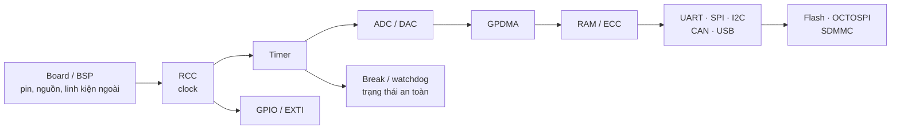
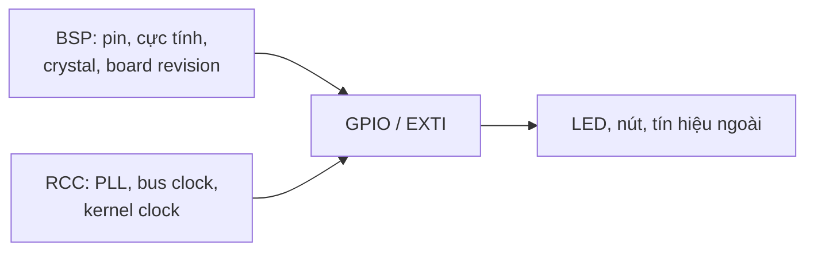
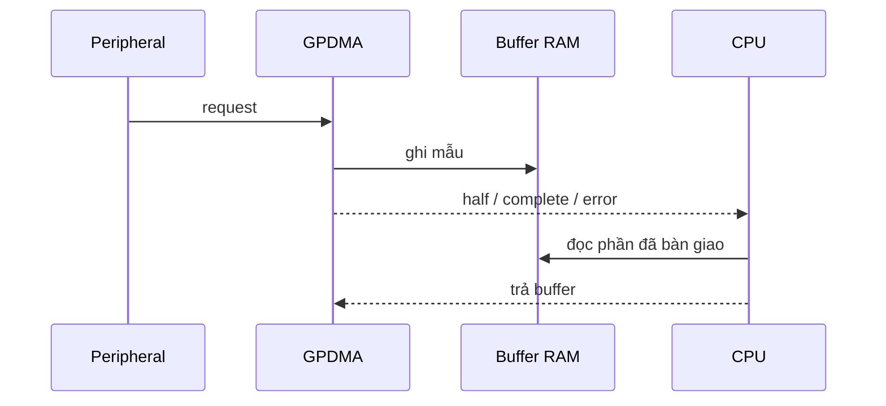
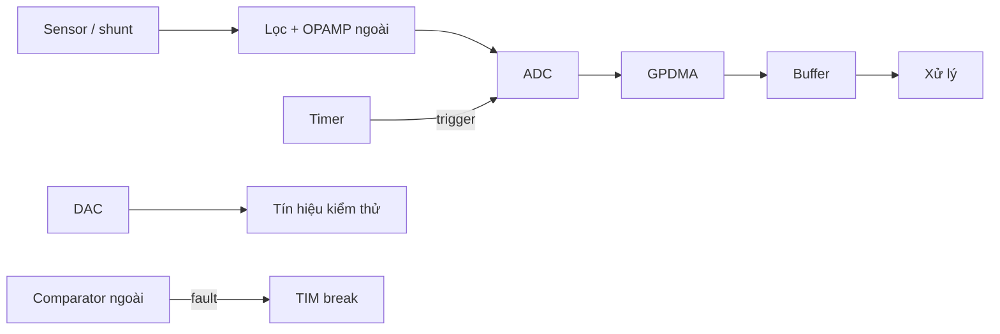
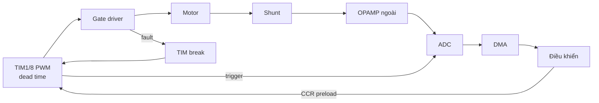

# Tài liệu ngoại vi STM32H523 — ý chính và sơ đồ

**Cách dùng:** học từ Bài 1 đến 10; mỗi bài làm một lab, đo một thông số và gây thử một lỗi. [Lịch lab](STM32H523_schedule.md) ghi thứ tự thực hành. [Bản đầy đủ 88 bài](STM32H523_reference_full_archive.md) dùng để tra thanh ghi, mode và lý thuyết sâu.

## Bản đồ ngoại vi

- **Bài 1–4:** tạo và thu tín hiệu đúng thời điểm.
- **Bài 5–8:** truyền và lưu dữ liệu không mất.
- **Bài 9–10:** quản lý nguồn, lỗi và ghép thành dự án.
- **H523:** có Timer, GPDMA, ADC, DAC; **không có OPAMP/COMP tích hợp**. SRAM2 và backup SRAM hỗ trợ ECC khi bật đúng option.

## Mẫu học cho mọi ngoại vi

- **Đường đi:** pin/clock → trigger/IRQ/DMA → buffer.
- **Tính trước:** tần số, thời gian, sai số, dung lượng buffer.
- **Đo:** một tín hiệu hoặc counter có thể kiểm lại.
- **Gây lỗi:** timeout, overrun, mất clock/thiết bị hoặc fault.
- **Chốt:** ngoại vi trở về trạng thái nào; ai được phép chạy lại?

## Bài 1 — BSP, RCC, GPIO, EXTI

- **Nắm:** BSP mô tả board; RCC cấp clock; GPIO chọn mode/pull/AF; EXTI đưa sự kiện vào NVIC.
- **Đo:** clock qua MCO/timer; điện áp chân; số IRQ khi nút bounce.
- **Lab:** cùng ứng dụng LED chạy trên hai cấu hình BSP khác cực tính.
- **Senior:** khi ngoại vi im lặng, kiểm **nguồn → clock → pin/AF → reset/enable** trước callback.

## Bài 2 — Timer

| Chức năng | Cần nhìn trên scope/logic analyzer |
|---|---|
| Timebase, PWM, one-pulse | Chu kỳ, duty, jitter, thời điểm cập nhật |
| Input capture, encoder | Period, pulse width, chiều và overflow |
| Đồng bộ TRGO/ITR | Độ lệch giữa hai ngoại vi |
| Complementary, dead time, break | Hai chân không dẫn chồng; fault tắt output |
| LPTIM, RTC, watchdog | Wakeup, timestamp, reset cause |

- **Tính:** PWM edge-aligned ≈ `fTIM / ((PSC+1)(ARR+1))`; center-aligned phải tính hai chiều đếm.
- **Lab:** 1 kHz → PWM 20 kHz → capture → encoder → complementary + break ở mức logic.
- **Senior:** break phải tắt output **không cần CPU**; đo tại chân gate driver, không chỉ xem register.

## Bài 3 — GPDMA, RAMCFG/ECC, cache

- **Nắm:** request, channel, width, alignment, circular/linked list, quyền sở hữu buffer.
- **ECC:** H523 có ECC ở SRAM2 và backup SRAM theo option; log địa chỉ và loại lỗi. ECC **không** phát hiện CPU/DMA ghi sai giá trị hợp lệ.
- **Cache:** H523 khác H7 Cortex-M7; xác định vùng nào thật sự được cache trước khi clean/invalidate.
- **Lab:** DMA copy pattern → UART RX vòng → ADC hai buffer; làm consumer chậm để tạo overrun.
- **Senior:** DMA complete không đồng nghĩa UART/SPI đã phát bit cuối; luôn đọc cờ kết thúc ngoại vi.

## Bài 4 — ADC, DAC và analog ngoài

- **ADC:** reference, trở kháng nguồn, sample time, conversion, calibration và sai số toàn đường.
- **DAC:** buffer, trigger, settling, timer+DMA waveform và underrun.
- **H523:** không có OPAMP/COMP nội; dùng mạch ngoài cho khuếch đại dòng và fault nhanh.
- **Lab:** ADC 0/25/50/75% thang đo; DAC loopback; thu 1 kHz bằng timer+DMA; đo offset op-amp.
- **Senior:** tín hiệu đã clipping hoặc lấy mẫu sai thời điểm không thể sửa bằng hệ số trong firmware.

## Bài 5 — UART/USART/LPUART, RS485, LIN

- **UART:** baud, frame, FIFO/IDLE, RX DMA, FE/PE/ORE.
- **RS485:** transceiver ngoài; giữ DE đến **UART TC**, không chỉ DMA TC.
- **LIN:** break → sync → protected ID → data → checksum; cần lịch phát.
- **Lab:** parser nhận frame bị chia/gộp, RX quá tải, đo thời điểm DE.
- **Senior:** frame ứng dụng có length giới hạn, timeout, version và checksum; không gửi nguyên C struct.

## Bài 6 — SPI/I2S, I2C/SMBus/PMBus, I3C

| Bus | Điểm quyết định | Lỗi chủ động |
|---|---|---|
| SPI | CPOL/CPHA, CS, word size, bus-busy | Sai mode, CS nhả sớm |
| I2S | WS/BCLK, sample/slot width | Underrun |
| I2C | Pull-up, START/restart, ACK | NACK, SDA stuck |
| SMBus/PMBus | PEC, command/Linear11 | PEC sai |
| I3C | SDR, DAA, CCC, IBI | Reset target, đổi địa chỉ |

- **Lab:** đọc sensor qua SPI và I2C; capture giao dịch; thử PEC và I3C nếu có thiết bị.
- **Senior:** phục hồi I2C phải xét bus có nhiều controller; không tự phát xung SCL khi controller khác đang giao dịch.

## Bài 7 — FDCAN, USB FS, UCPD

- **FDCAN:** timing, filter, FIFO, Classical/FD, bus-off; test thật cần transceiver + node ACK.
- **USB FS:** descriptor, endpoint, enumeration; CDC là dòng byte, có thể chia/gộp frame.
- **UCPD:** CC/PD điều khiển vai trò và hợp đồng nguồn; đổi điện áp cần power path phù hợp.
- **Lab:** CAN loopback rồi hai node; USB CDC reconnect; quan sát CC/PD nếu board hỗ trợ.
- **Senior:** nghiệm thu **bus-off/reconnect**, không chỉ throughput lúc kết nối ổn.

## Bài 8 — Flash, OCTOSPI, FMC, SDMMC, DCMI/PSSI

- **Flash:** erase/program granularity, endurance, ECC; journal có version, sequence, CRC, commit.
- **OCTOSPI:** indirect/memory-mapped, dummy cycles, DLYB; NOR mapped vẫn cần lệnh program/erase.
- **FMC/SDMMC/DCMI/PSSI:** kiểm package, pin và bandwidth trước khi làm lab.
- **Lab:** cắt ghi cấu hình ở từng bước rồi reboot; đọc pattern OCTOSPI; logger SDMMC nếu có card.
- **Senior:** phép thử quan trọng nhất của lưu trữ là **dữ liệu nào còn hợp lệ sau mất nguồn**.

## Bài 9 — Nguồn, RTC/LPTIM, watchdog

- **Nguồn:** BOR/PVD/PVM, VOS, reset flags; đọc reset cause trước khi xóa.
- **Thời gian dài:** LPTIM/RTC/TAMP, nguồn clock, wakeup, retention.
- **Watchdog:** feed khi các chức năng quan trọng đều có tiến độ; đo reset khi một chức năng treo.
- **Lab:** đo dòng Run/Stop, chu kỳ wakeup và log reset cause sau lỗi.
- **Senior:** debug freeze đổi hành vi timer/watchdog; đánh giá production khi không có debugger.

## Bài 10 — Ba dự án ghép ngoại vi

| Dự án | Đường dữ liệu | Đo và gây lỗi |
|---|---|---|
| Logger | Timer/RTC → ADC/I2C → DMA → Flash/SDMMC | Jitter, overrun, mất nguồn |
| Gateway | FDCAN/RS485 → buffer → USB/UART | Bus-off, frame sai, RX quá tải |
| BLDC | TIM1/8 → ADC → DMA → cập nhật PWM | Cửa lấy mẫu, deadline, break |

### BLDC: đường đo và bảo vệ

- **Thứ tự:** PWM/break mức logic → dòng giả lập → ADC trigger + DMA → đo deadline → mới ghép mạch công suất.
- **Chọn thuật toán:** six-step Hall đơn giản; sensorless cần back-EMF và khởi động; FOC cần đo dòng/góc rotor và timing chặt.
- **Senior:** comparator ngoài tới break bảo vệ nhanh; phần mềm ghi lỗi và quyết định điều kiện re-arm.

## Chỉ mở ngoại vi nâng cao khi dự án cần

| Nhu cầu | Học trên dòng phù hợp |
|---|---|
| Cache M7, đa lõi, Ethernet/USB HS | H7: TCM, AXI, MDMA, HSEM |
| Năng lượng thấp | U5/L5: LPBAM, retention, MSI, ECC/parity |
| Điều khiển công suất nhanh | Chip có HRTIM, OPAMP/COMP nội |
| Màn hình/âm thanh/camera | LTDC, DMA2D, DSI, SAI, DCMI |

Tra [Bài 69–88 trong bản đầy đủ](STM32H523_reference_full_archive.md); kiểm đúng datasheet/RM của SKU mới, không gán ngoại vi H7/U5/L5 cho H523.

**Nguồn phần cứng:** [datasheet STM32H523](https://www.st.com/resource/en/datasheet/stm32h523ce.pdf), [RM0481](https://www.st.com/resource/en/reference_manual/rm0481-stm32h52333xx-stm32h56263xx-and-stm32h573xx-armbased-32bit-mcus-stmicroelectronics.pdf), [ST motor control](https://wiki.st.com/stm32mcu/wiki/STM32MotorControl:Motor_Control_Boards_Description).
