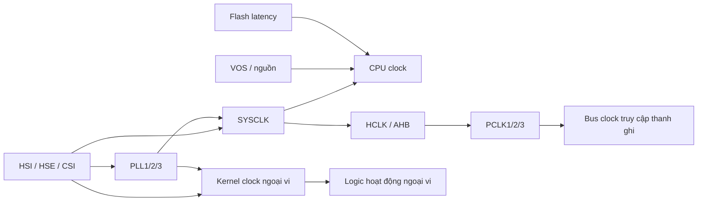

# Bài 01 — Clock, nguồn và reset/boot trên STM32H533CE

> Phạm vi: STM32H533CE, 512 KiB Flash, Cortex‑M33, tối đa 250 MHz; ví dụ giả định dự án STM32CubeH5 dùng `stm32h5xx_hal.h`, TrustZone chưa bật. Đây là bài về **cách suy luận và kiểm chứng cấu hình**, không phải một bộ giá trị PLL dùng cho mọi bo mạch.

## Mục tiêu học

Sau bài này, bạn có thể vẽ đường đi từ nguồn dao động đến CPU và một ngoại vi; giải thích vì sao VOS và Flash latency phải phù hợp tần số; đọc nguyên nhân reset trước khi xóa cờ; phân biệt boot từ Flash và System memory; kiểm tra clock thực tế bằng MCO hoặc timer. Đầu ra thực hành là một chương trình đọc cờ reset, in/quan sát các tần số do HAL tính và nháy LED bằng SysTick.

## 1. Bản đồ kiến thức và thứ tự thực hiện



Hãy học theo chuỗi: (1) reset mặc định; (2) cây clock; (3) miền nguồn và VOS; (4) trình tự chuyển clock; (5) cờ reset; (6) boot; (7) đo kiểm trên board. Phần 1–3 là điều kiện tiên quyết của phần 4; chỉ học Stop/Standby sau khi đã đo được Run mode. [RM0481 §10–11, tr. 426–503](../doc/rm0481-stm32h523533xx-stm32h543553xx-stm32h562xx-and-stm32h563573xx-armbased-32bit-mcus-stmicroelectronics%20%281%29.pdf)

## 2. Reset mặc định và cây clock

**Định nghĩa.** Clock là chuỗi cạnh thời gian để CPU và các khối số tiến trạng thái; RCC chọn nguồn, chia tần số và cấp clock tới từng miền. PWR đặt điều kiện điện áp để mạch hoạt động đúng ở tốc độ đó. Reset đưa các khối về trạng thái khởi đầu; boot chọn nơi CPU lấy chương trình. Một cấu hình clock tốt giải quyết bài toán **đủ tốc độ, đủ độ chính xác, đủ tiết kiệm điện** cho sản phẩm, không đơn giản là chạy nhanh nhất. [RM0481 §10–11](../doc/rm0481-stm32h523533xx-stm32h543553xx-stm32h562xx-and-stm32h563573xx-armbased-32bit-mcus-stmicroelectronics%20%281%29.pdf).

| Lựa chọn | Cơ chế và lý do tồn tại | Khi dùng thực tế | Đánh đổi/cách phát hiện sai |
|---|---|---|---|
| HSI/CSI nội | RC nội tự khởi động, không cần linh kiện ngoài; làm nguồn boot/fallback. | Bring-up, sản phẩm không đòi sai số thời gian nhỏ. | Sai số theo điện áp/nhiệt; đo MCO và kiểm tra baud/timing ở điều kiện biên. |
| HSE ngoài | Thạch anh/clock ngoài tạo chuẩn ổn định hơn. | Giao tiếp hoặc đo lường cần sai số clock được kiểm soát. | Tốn chân/linh kiện/thời gian khởi động; phải có phần cứng thật và chờ `HSERDY`, cân nhắc CSS. |
| LSE/LSI thấp tần | Cấp nhịp cho RTC/IWDG/low-power; LSE từ thạch anh, LSI từ RC nội. | Đồng hồ chạy qua Stop/VBAT (LSE), watchdog độc lập (LSI). | LSI sai số lớn hơn; LSE cần phần cứng và thời gian ổn định. Không lấy 32 kHz danh định để cam kết độ chính xác dài ngày. |
| PLL | Nhân/chia từ nguồn đã chọn để đạt các tần số cần thiết. | CPU nhanh nhưng bus và ngoại vi ở tốc độ riêng. | Jitter, công suất và giới hạn VCO; sai bộ chia có thể làm UART/timer chạy sai dù CPU vẫn chạy. |
| Prescaler AHB/APB và kernel mux | Chia clock cho miền bus, chọn clock logic ngoại vi độc lập. | Giới hạn bus, giữ baud/tần số lấy mẫu khi đổi SYSCLK. | Đọc thanh ghi được chưa có nghĩa kernel clock đang chạy; ghi lại toàn bộ clock tree khi debug. |

**VOS là mode hiệu năng của nguồn lõi.** VOS cao hiệu năng cấp điện áp/khả năng chuyển mạch để CPU đạt tần số cao; đổi lại là công suất và nhiệt. VOS thấp hiệu năng giảm tiêu thụ khi workload nhẹ nhưng giảm trần tần số. Flash wait state giải quyết việc Flash chậm hơn chu kỳ CPU ở clock cao bằng cách chèn chu kỳ đợi; thiếu wait state có thể lỗi chạy ngẫu nhiên, thừa wait state giảm hiệu năng. Ví dụ thiết bị đo ngủ phần lớn thời gian có thể chạy cấu hình tiết kiệm rồi nâng VOS/Flash latency trước khi tăng PLL để xử lý burst. Bảng tần số tương ứng cho H533CE nằm ở DS14539 Rev 3 bảng 20–21; thứ tự chuyển được giải thích ở §3 dưới đây. [DS14539 §5](../doc/DS_stm32h533ce%20%281%29.pdf).

**Sleep, Stop, Standby giải quyết ba mức thời gian nhàn rỗi khác nhau.** Sleep dừng lõi để giảm dòng mà vẫn giữ phần lớn clock ngoại vi, wake nhanh; dùng khi chờ IRQ ngắn. Stop dừng phần lớn clock nhanh và giữ trạng thái RAM thích hợp, dòng thấp hơn nhưng cần phục hồi clock/ngoại vi sau wake; dùng khi chờ cảm biến theo giây/phút. Standby tắt sâu hơn, trạng thái chạy thường mất và thức dậy qua đường reset/boot; dùng cho thời gian nhàn rỗi dài khi trạng thái quan trọng đã lưu ở backup/nonvolatile. Chọn bằng năng lượng cả chu kỳ `E = P_run·t_run + P_sleep·t_sleep + E_wake`, không chỉ bằng dòng ngủ công bố. Đo dòng trên board khi tháo debugger và tắt tải ngoài. [RM0481 §10.8](../doc/rm0481-stm32h523533xx-stm32h543553xx-stm32h562xx-and-stm32h563573xx-armbased-32bit-mcus-stmicroelectronics%20%281%29.pdf).

Sau reset hệ thống, HSI được chọn làm SYSCLK ở **32 MHz**. Các nguồn khác gồm CSI, HSE (thạch anh hoặc clock ngoài 4–50 MHz), LSI 32 kHz danh định, LSE 32,768 kHz, HSI48 và các PLL. Chỉ nguồn đã ổn định (`RDY`) mới có thể cấp clock. CPU, AHB và APB có các bộ chia riêng; một ngoại vi có thể cần **hai clock**: bus clock để đọc/ghi thanh ghi và kernel clock để chạy logic truyền/nhận. Vì vậy, `__HAL_RCC_USARTx_CLK_ENABLE()` chưa đủ nếu nguồn kernel clock tương ứng bị chọn sai hoặc tắt. [RM0481 §11.4, tr. 483, 495, 498–500](../doc/rm0481-stm32h523533xx-stm32h543553xx-stm32h562xx-and-stm32h563573xx-armbased-32bit-mcus-stmicroelectronics%20%281%29.pdf)

Trên H533CE, đừng suy từ sơ đồ toàn họ ra một chân HSE/LSE đã có thạch anh. Xem sơ đồ board và pinout LQFP48/UFQFPN48 trước khi dùng HSE hoặc LSE. HSI phù hợp bài đầu vì không phụ thuộc phần cứng ngoài; khi cần chính xác cho giao thức hoặc thời gian dài, đánh giá sai số nguồn dao động trong datasheet. [DS14539 Rev 3 §4.1, tr. 61–62; §5, tr. 99–102](../doc/DS_stm32h533ce%20%281%29.pdf)

**Câu hỏi cốt lõi:** Nếu CPU là 250 MHz nhưng UART chọn HSI làm kernel clock, đổi prescaler APB có làm baud rate đổi không? Không trực tiếp; phải xem UART kernel source và công thức baud. Bus clock vẫn phải được cấp để truy cập các thanh ghi UART.

## 3. Nguồn, VOS và Flash

PWR quản lý các miền VCORE, VDD, backup/VBAT và analog/VDDA. Các giám sát POR/PDR, BOR, PVD/AVD giúp phát hiện điện áp không phù hợp. VOS là mức điện áp lõi tương ứng khả năng chạy nhanh; sau reset, Run mode ở **VOS3**. Theo giới hạn datasheet: VOS3 ≤ **100 MHz**, VOS2 ≤ **150 MHz**, VOS1 ≤ **200 MHz**, VOS0 ≤ **250 MHz** cho CPU/HCLK. Muốn lên 250 MHz, phải cấu hình VOS0 và kiểm tra đủ điều kiện về nguồn/nhiệt độ; không chỉ tăng PLL. [RM0481 §10.4–10.7, tr. 428–444; DS14539 Rev 3 bảng 20–21, tr. 99–102](../doc/DS_stm32h533ce%20%281%29.pdf)

Flash cần số wait states phù hợp với tần số và VOS. Bảng cụ thể nằm trong phần đặc tính Flash của datasheet/reference manual; không dùng một giá trị latency cố định cho mọi cấu hình. Nếu chạy code từ Flash, một cấu hình latency thiếu có thể gây lỗi ngẫu nhiên khó tái hiện. Khi **tăng** clock: nâng VOS → đợi cờ ổn định → tăng Flash latency → cấu hình/đợi PLL → chuyển SYSCLK → cập nhật biến/tick. Khi **giảm** clock: chuyển về nguồn chậm, xác nhận, rồi mới hạ latency/VOS. Đây là trật tự an toàn ở mức nguyên tắc; dùng CubeMX/HAL sinh cấu hình cụ thể theo VDD và tần số mục tiêu. [RM0481 §10.7.1, tr. 443; §11.4.8, tr. 495; §7 Flash, tr. 277–390](../doc/rm0481-stm32h523533xx-stm32h543553xx-stm32h562xx-and-stm32h563573xx-armbased-32bit-mcus-stmicroelectronics%20%281%29.pdf)

**Lưu ý riêng cho CE:** reference manual dùng chung nhiều biến thể. Ví dụ SMPS chỉ có trên STM32H563/H573; không thiết kế nguồn H533CE theo mô tả SMPS trong RM. [RM0481 §10.2, tr. 426; DS14539 §3.10, tr. 27–31](../doc/DS_stm32h533ce%20%281%29.pdf)

## 4. Trình tự thanh ghi cần hiểu

| Bước | Thanh ghi/bit tiêu biểu | Điều phải xác nhận |
|---|---|---|
| Đọc reset | `RCC_RSR` rồi đặt `RMVF` | Lưu snapshot trước khi xóa; nhiều cờ có thể cùng bằng 1. |
| Chọn nguồn | `RCC_CR` (`HSION/HSIRDY`, `HSEON/HSERDY`, `PLL1ON/PLL1RDY`) | Không chuyển sang nguồn chưa `RDY`. |
| Nâng VOS | `PWR_VOSCR`, `PWR_VOSSR` | Đợi mức điện áp sẵn sàng trước khi tăng clock. |
| Cấu hình PLL | `RCC_PLL1CFGR`, `RCC_PLL1DIVR`, `RCC_PLL1FRACR` | Tính tần số đầu vào/VCO/đầu ra; chỉ sửa tham số khi PLL tắt. |
| Chia clock và chuyển SYSCLK | `RCC_CFGR1`, `RCC_CFGR2` | Đọc trạng thái source đã chuyển; tính lại HCLK/PCLK. |
| Clock ngoại vi | `RCC_AHBxENR`, `RCC_APBxENR`, `RCC_CCIPRx` | Bus enable và kernel selection là hai việc khác nhau. |

Các tên bit cụ thể phụ thuộc device header của STM32CubeH5; đối chiếu trước khi viết mã trực tiếp. PLL1 không cho thay tham số chia khi đang bật; nếu PLL1 đang cấp SYSCLK thì phần cứng cũng chặn tắt nó. [RM0481 §11.4, tr. 490–491; §11.8, tr. 511–595](../doc/rm0481-stm32h523533xx-stm32h543553xx-stm32h562xx-and-stm32h563573xx-armbased-32bit-mcus-stmicroelectronics%20%281%29.pdf)

## 5. Code minh họa: quan sát clock và reset

Ví dụ này dùng **HAL + CMSIS**, dành cho project STM32CubeH5 đã có startup, linker script, `SystemClock_Config()` do CubeMX sinh và tick HAL. Chọn một chân LED thực sự có trên board; `GPIO_PIN_5` của GPIOA dưới đây **chỉ là ví dụ**, cần đối chiếu schematic. Đặt code sau vào `main.c` và giữ hàm `SystemClock_Config()` do CubeMX tạo. Cấu hình clock trên CubeMX trước ở 32 MHz HSI để thử, sau đó mới thử cấu hình nhanh hơn.

```c
#include "stm32h5xx_hal.h"
#include <stdint.h>

void SystemClock_Config(void); /* Hàm CubeMX sinh ở phần khác của main.c. */
static volatile uint32_t reset_snapshot;
static volatile uint32_t sys_hz, hclk_hz, pclk1_hz;

static void Clock_Error(void)
{
    __disable_irq();
    while (1) { __BKPT(0); }
}

int main(void)
{
    /* Đọc càng sớm càng tốt; ở một project lớn, lưu trong startup hook
       trước khi middleware hoặc bootloader kịp xóa cờ. */
    reset_snapshot = RCC->RSR;
    RCC->RSR |= RCC_RSR_RMVF;  /* Xóa cờ sau khi đã lưu. */

    HAL_Init();
    SystemClock_Config();      /* Hàm CubeMX sinh riêng cho board. */

    sys_hz   = HAL_RCC_GetSysClockFreq();
    hclk_hz  = HAL_RCC_GetHCLKFreq();
    pclk1_hz = HAL_RCC_GetPCLK1Freq();
    if (sys_hz == 0U || hclk_hz == 0U) Clock_Error();

    __HAL_RCC_GPIOA_CLK_ENABLE();
    GPIO_InitTypeDef pin = {0};
    pin.Pin   = GPIO_PIN_5;    /* Thay theo schematic. */
    pin.Mode  = GPIO_MODE_OUTPUT_PP;
    pin.Pull  = GPIO_NOPULL;
    pin.Speed = GPIO_SPEED_FREQ_LOW;
    HAL_GPIO_Init(GPIOA, &pin);

    while (1) {
        HAL_GPIO_TogglePin(GPIOA, GPIO_PIN_5);
        HAL_Delay(500);
    }
}
```

Quan sát `reset_snapshot`, `sys_hz`, `hclk_hz`, `pclk1_hz` trong debugger. `HAL_RCC_Get*Freq()` là giá trị **tính từ cấu hình**, không phải phép đo vật lý; nếu khai báo `HSE_VALUE` sai, số hiển thị cũng sai. Để đo thật, xuất MCO ra chân hỗ trợ MCO rồi dùng logic analyzer/oscilloscope, hoặc đo tương đối bằng timer dựa vào nguồn chuẩn. Nếu debugger giữ CPU trong khi SysTick vẫn thay đổi, hành vi thời gian có thể khác chạy tự do. [RM0481 §11.4, tr. 483–503; §11.8.46, tr. 592–593](../doc/rm0481-stm32h523533xx-stm32h543553xx-stm32h562xx-and-stm32h563573xx-armbased-32bit-mcus-stmicroelectronics%20%281%29.pdf)

**Chú ý biên dịch:** khi chèn vào `main.c` do CubeMX sinh, giữ một hàm `main()` và một định nghĩa `SystemClock_Config()` duy nhất; nếu bật TrustZone, mã đọc/cấu hình PWR/RCC có thể thuộc secure world và cần chia đúng quyền. [DS14539 §3.10.5, §3.12.1, tr. 31–32](../doc/DS_stm32h533ce%20%281%29.pdf)

## 6. Reset và boot

**Reset nguồn** do POR/PDR/BOR, **system reset** do NRST, watchdog, lệnh software hoặc nguồn khác; **backup domain reset** là miền riêng, có thể ảnh hưởng RTC/LSE/backup registers. `RCC_RSR` có các cờ `BORRSTF`, `PINRSTF`, `IWDGRSTF`, `WWDGRSTF`, `SFTRSTF`, `LPWRRSTF`. Một lần watchdog reset cũng có thể đặt `PINRSTF`, vì reset nội bộ phát xung ra NRST: đừng phân loại chỉ bằng một cờ. Sau khi chụp snapshot, đặt `RMVF` để cờ của lần sau không bị lẫn. [RM0481 §11.3, tr. 480–482; §11.8.46, tr. 592–593](../doc/rm0481-stm32h523533xx-stm32h543553xx-stm32h562xx-and-stm32h563573xx-armbased-32bit-mcus-stmicroelectronics%20%281%29.pdf)

Boot H533 có lựa chọn qua BOOT0 và option bytes `NSBOOTADD`/`SECBOOTADD`; đích có thể là Flash người dùng hoặc System memory chứa bootloader và dịch vụ bảo mật ST. Khi TrustZone bật, boot address phải ở vùng secure. **Không áp bảng boot của H523/H543 cho H533**: đọc đúng bảng 27–28 của RM. Trước khi sửa option bytes, ghi lại cấu hình cũ và chuẩn bị đường khôi phục bằng SWD/bootloader; sai địa chỉ boot hoặc phân vùng secure có thể làm ứng dụng trông như “brick”. [DS14539 §3.7, tr. 23–24; RM0481 §4.2, tr. 191; §7.4.6, tr. 297](../doc/rm0481-stm32h523533xx-stm32h543553xx-stm32h562xx-and-stm32h563573xx-armbased-32bit-mcus-stmicroelectronics%20%281%29.pdf)

## 7. Kỹ thuật triển khai như firmware production

1. **Định nghĩa clock contract:** một file cấu hình ghi VDD, nguồn HSE thực tế, mục tiêu SYSCLK/HCLK/PCLK, nguồn kernel của từng ngoại vi, VOS, Flash latency. Review mỗi thay đổi clock như thay đổi giao diện hệ thống.
2. **Dùng timeout cho mọi `RDY`:** không chờ vô hạn trong startup. Nếu HSE/PLL lỗi, ghi mã lỗi, chuyển về HSI an toàn khi có thể, rồi báo tình trạng qua UART/LED/watchdog.
3. **Xử lý CSS:** nếu dùng HSE, cân nhắc Clock Security System; lỗi HSE có thể phát NMI và chuyển nguồn. Trong NMI phải xóa cờ HSECSSF theo RM, sau đó vô hiệu hóa hoặc tái cấu hình những ngoại vi phụ thuộc clock đã mất.
4. **Khôi phục sau Stop:** khi thoát Stop, SYSCLK có thể trở về HSI/CSI; PLL và HSE bị tắt. Tái tạo clock cần thiết rồi cập nhật tick/thời gian, baud, timer theo cấu hình thực tế.
5. **Đo thay vì tin cấu hình:** đo MCO và một GPIO toggle theo timer; so sánh với giá trị tính toán. Sự khác nhau gợi ý sai `HSE_VALUE`, chia xung, nguồn PLL, hoặc chế độ debug.
6. **Log reset bền vững:** lưu `RCC_RSR`, thời điểm uptime và lỗi gần nhất vào vùng backup nếu ứng dụng cần điều tra lỗi sau khởi động. Tránh ghi Flash trên mọi reset vì hao mòn và tạo thêm điểm lỗi.

CSS và hành vi Stop được mô tả ở [RM0481 §11.4.9–11.4.10, tr. 495–497](../doc/rm0481-stm32h523533xx-stm32h543553xx-stm32h562xx-and-stm32h563573xx-armbased-32bit-mcus-stmicroelectronics%20%281%29.pdf).

## 8. Bài tập và tiêu chí hoàn thành

| Bài tập | Kết quả cần thấy |
|---|---|
| A. Reset bằng nút NRST, software reset (`NVIC_SystemReset()`), watchdog | Chụp được `RCC_RSR` khác nhau; giải thích vì sao có nhiều cờ cùng bật. |
| B. Chạy HSI mặc định, đo MCO hoặc nhịp timer | Sai khác giữa phép đo và giá trị tính nằm trong sai số nguồn/thiết bị đo. |
| C. Tạo cấu hình VOS2 hoặc VOS1 trong CubeMX | Ghi rõ tần số CPU/HCLK/PCLK, Flash latency, nguồn PLL; kiểm tra từng `RDY`. |
| D. Đổi kernel clock UART trong khi giữ APB | Tính lại baud divisor, xác nhận bằng logic analyzer. |
| E. Nếu board có HSE: rút/bỏ nguồn HSE có kiểm soát trong lab | Quan sát CSS/NMI và chính sách fallback. Không thử trên hệ đang vận hành tải nguy hiểm. |

**Tự kiểm tra:** (1) HSI sau reset là bao nhiêu MHz? (2) Vì sao 250 MHz đòi VOS0? (3) `PCLK` và kernel clock khác gì? (4) Vì sao phải lưu `RCC_RSR` trước khi xóa? (5) Sau Stop, vì sao delay/UART có thể sai? (6) Bảng boot nào áp dụng cho H533? Trả lời được bằng sơ đồ và một phép đo trên board thì hoàn thành bài.

## Nguồn chính

- [DS14539 Rev 3 — STM32H533xx datasheet](../doc/DS_stm32h533ce%20%281%29.pdf): §3.7, §3.10, §3.12, bảng 20–21, pinout §4.
- [RM0481 Rev 5 — reference manual](../doc/rm0481-stm32h523533xx-stm32h543553xx-stm32h562xx-and-stm32h563573xx-armbased-32bit-mcus-stmicroelectronics%20%281%29.pdf): §4.2 boot H533, §10 PWR, §11 RCC.
- [PM0264 — Cortex‑M33 programming manual](../doc/pm0264-stm32-cortexm33-mcus-and-mpus-programming-manual-stmicroelectronics%20%281%29.pdf): reset exception, SysTick, NVIC và lệnh `WFI/WFE` khi học low-power.
