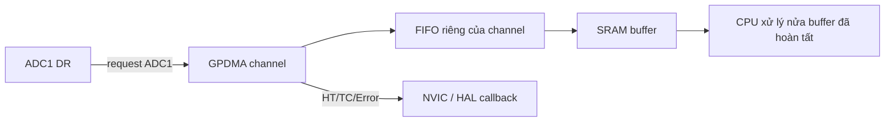

# Bài 09 — GPDMA1/2 trên STM32H533CE

> Phạm vi: GPDMA1 và GPDMA2 của **STM32H533CE**. Ví dụ dùng ADC1 → SRAM qua HAL STM32CubeH5, với cấu hình ADC/GPDMA do CubeMX sinh. Cần đối chiếu phiên bản CubeH5 đang dùng vì tên callback và thủ tục tạo linked list có thể khác theo bản thư viện.

## Mục tiêu và kế hoạch học

Hoàn thành bài này, bạn phải: giải thích luồng request → channel → FIFO → bus master → SRAM; cấu hình một lần truyền peripheral-to-memory; phân biệt complete/half/error; chọn channel phù hợp kích thước FIFO; thiết kế ping-pong/circular buffer bằng linked list; và chứng minh dữ liệu CPU đọc là dữ liệu GPDMA vừa ghi. Học theo thứ tự **DMA một block → IRQ → vòng đệm → xử lý lỗi → đo throughput/latency**. Đừng bắt đầu bằng linked list trước khi một block chạy đúng.



GPDMA là AHB bus master, hoạt động độc lập CPU; nó không “copy bằng interrupt”. IRQ chỉ báo mốc hoặc lỗi. Hai instance GPDMA1/2 mỗi instance có **8 channel 0–7**; cả hai nhìn cùng danh mục request/trigger. Channel 0–3 có FIFO **8 byte** và địa chỉ tuyến tính; 4–5 FIFO **32 byte**; 6–7 FIFO **32 byte + 2D addressing**. Chọn channel nhỏ cho UART/ADC đơn giản, giữ 6–7 cho tác vụ cần 2D hoặc băng thông lớn. [RM0481 Rev 5 §16.1–16.3.2, tr. 677–679](../doc/rm0481-stm32h523533xx-stm32h543553xx-stm32h562xx-and-stm32h563573xx-armbased-32bit-mcus-stmicroelectronics%20%281%29.pdf)

## DMA là gì và chọn luồng truyền

**GPDMA** là bus master chuyển dữ liệu giữa địa chỉ ngoại vi và bộ nhớ mà CPU không phải thực hiện từng lệnh load/store. Ngoại vi phát request khi có dữ liệu hoặc chỗ trống; DMA đọc nguồn, ghi đích, cập nhật địa chỉ/bộ đếm rồi phát cờ half/complete/error. Nó giảm CPU và jitter phục vụ, nhưng không làm ngoại vi tạo dữ liệu nhanh hơn và không tự kiểm tra nội dung mẫu. CPU vẫn phải quản lý quyền sở hữu buffer, timeout và lỗi của *cả* DMA lẫn ngoại vi (RM0481 §16).

| Cách dùng | Vấn đề giải quyết và cơ chế | Chọn khi nào, đánh đổi |
|---|---|---|
| Normal, một block | Dừng sau `BNDT` byte. | Gói hữu hạn như một lần ADC burst hoặc TX frame; đơn giản, nhưng phải tái cấu hình/restart, khoảng hở có thể mất dữ liệu. |
| Circular / linked-list vòng | Nạp lại node/địa chỉ để stream liên tục. | Audio, ADC đều đặn, RX dài hạn; CPU phải xử lý xong vùng vừa hoàn thành trước khi DMA quay lại ghi đè. |
| Half/full callback | Chia buffer thành hai vùng để DMA ghi một nửa trong lúc CPU xử lý nửa kia. | Stream ổn định; cần deadline rõ: thời gian xử lý < thời gian lấp nửa buffer, và không giữ con trỏ sang nửa đang ghi. |
| Linked list | Mỗi node chứa cấu hình cho block tiếp theo. | Chuỗi địa chỉ hoặc kích thước khác nhau, giảm can thiệp CPU; tốn RAM, phải căn địa chỉ và kiểm soát tính hợp lệ/thuộc tính bảo mật của node. |
| Peripheral request / software trigger | Request giữ nhịp theo khả năng ngoại vi, software dùng cho copy bộ nhớ. | Không dùng software request tự do cho thanh ghi data khi thiết bị chưa sẵn sàng; FIFO và width phải khớp dữ liệu ngoại vi. |

Ví dụ ADC 12 bit lưu `uint16_t`: chọn nguồn `ADC_DR` cố định, đích SRAM tăng địa chỉ, độ rộng halfword, `BNDT = 2 × số mẫu` byte. Timer ấn định nhịp ADC; ADC phát request khi conversion xong; DMA chuyển mẫu. Nếu request đến quá nhanh, ADC có thể overrun dù GPDMA không báo lỗi bus. Đếm số mẫu/sequence hoặc gắn timestamp ở tầng ứng dụng khi yêu cầu phát hiện mất mẫu.

## 1. Kiểm tra phần cứng H533CE trước khi cấu hình

Datasheet ghi H533CE có **2 ADC 12 bit, 10 kênh analog khả dụng theo mã CE**, SRAM hệ thống 272 KiB chia 128+80+64 KiB và không có SDMMC/DCMI/PSSI. RM0481 bao phủ cả các chip khác nên các request SDMMC hoặc DCMI trong bảng tổng quát không biến chúng thành ngoại vi dùng được trên CE. GPDMA truy cập được Flash, SRAM1/2/3, backup SRAM, ngoại vi và bộ nhớ ngoài qua OCTOSPI; với bài đầu, dùng buffer trong SRAM nội và xác nhận linker đặt nó ở vùng hợp lệ. [DS14539 Rev 3 bảng 2, tr. 15–16](../doc/DS_stm32h533ce%20%281%29.pdf); [RM0481 §2.1.5, tr. 123](../doc/rm0481-stm32h523533xx-stm32h543553xx-stm32h562xx-and-stm32h563573xx-armbased-32bit-mcus-stmicroelectronics%20%281%29.pdf)

## 2. Từ request đến một block truyền

1. Ngoại vi tạo hardware request (ví dụ ADC1 DMA request). Chọn nó ở `GPDMA_CxTR2.REQSEL` và để `SWREQ=0`. Trong bảng RM: ADC1=0, ADC2=1, SPI1_RX=6, SPI1_TX=7, USART1_RX=21, USART1_TX=22. Những số này là **mã request**, không phải số channel. Không gán cùng một request cho hai channel đang active; phần cứng không báo user-setting error cho trường hợp này. [RM0481 §16.3.4, tr. 679–684; §16.8.11, tr. 739–743](../doc/rm0481-stm32h523533xx-stm32h543553xx-stm32h562xx-and-stm32h563573xx-armbased-32bit-mcus-stmicroelectronics%20%281%29.pdf)
2. `CxSAR` là địa chỉ nguồn, `CxDAR` là đích. ADC→RAM: nguồn là thanh ghi data cố định (`SINC=0`), đích là buffer tăng dần (`DINC=1`). `CxTR1` chọn độ rộng nguồn/đích và burst; địa chỉ phải thẳng hàng với độ rộng tương ứng. `CxBR1.BNDT` là **số byte nguồn** trong block, không mặc định là số phần tử C. Dùng `uint16_t sample[256]` thì block là 512 byte nếu mỗi ADC sample 16 bit. [RM0481 §16.4.10, tr. 707–713; §16.8.10–16.8.15, tr. 735–749](../doc/rm0481-stm32h523533xx-stm32h543553xx-stm32h562xx-and-stm32h563573xx-armbased-32bit-mcus-stmicroelectronics%20%281%29.pdf)
3. Bật clock bus của GPDMA và ngoại vi nguồn; cấu hình ADC, trigger/timing, đường request và IRQ; xóa cờ cũ; cuối cùng enable channel/ADC theo trình tự HAL hoặc LL của driver. Khi channel chuyển về idle sau complete, có thể nạp block kế tiếp. Với hardware request, DMA không tự làm ADC bắt đầu lấy mẫu: ADC vẫn phải được bật và có trigger. [RM0481 §16.4.2, tr. 688–689; §16.4.11, tr. 714–718](../doc/rm0481-stm32h523533xx-stm32h543553xx-stm32h562xx-and-stm32h563573xx-armbased-32bit-mcus-stmicroelectronics%20%281%29.pdf)

### Cách chọn độ rộng và FIFO

Độ rộng byte/halfword/word của source và destination phải khớp dữ liệu ngoại vi và căn lề buffer. FIFO là chỗ đệm giúp ghép burst, không phải RAM ứng dụng để đọc. Với tốc độ mẫu cao, xem `CxSR.FIFOL` khi debug, đo worst-case bus contention và cân nhắc channel 4–7. Không giả định burst dài hơn luôn nhanh hơn: peripheral request, FIFO 8 byte và arbitration bus có thể là giới hạn. [RM0481 §16.3.2, tr. 678–679; §16.4.10–11, tr. 707–718](../doc/rm0481-stm32h523533xx-stm32h543553xx-stm32h562xx-and-stm32h563573xx-armbased-32bit-mcus-stmicroelectronics%20%281%29.pdf)

## 3. Ví dụ C: ADC1 lấy 256 mẫu vào SRAM

Ví dụ tích hợp vào project STM32CubeH5 đã cấu hình bằng CubeMX: ADC1 có một kênh hợp lệ trên **pin CE thật**, trigger từ timer hoặc software theo mục tiêu, data alignment right, DMA request bật; GPDMA1 channel 0 request ADC1, hướng peripheral→memory, source fixed/destination increment, source/destination halfword, IRQ channel bật; HAL handle ADC liên kết DMA bằng `__HAL_LINKDMA` trong `HAL_ADC_MspInit`. Trong CubeMX, chọn **normal** mode cho ví dụ một block. `MX_GPDMA1_Init()` phải chạy trước lúc `HAL_ADC_Start_DMA()`; thứ tự `MX_ADC1_Init()` và `MX_GPDMA1_Init()` phụ thuộc code CubeMX sinh, kiểm tra liên kết handle trong `HAL_ADC_MspInit`.

```c
/* Đoạn chèn vào main.c CubeMX; giữ một main() duy nhất. */
#include "stm32h5xx_hal.h"
#include <stdint.h>

#define ADC_SAMPLES 256U
extern ADC_HandleTypeDef hadc1;

/* SRAM nội, sống suốt quá trình DMA; tránh biến local trên stack. */
static uint16_t adc_buf[ADC_SAMPLES] __attribute__((aligned(4)));
static volatile uint8_t adc_done;
static volatile uint8_t adc_failed;
static volatile uint32_t adc_error_code;

static void StartAdcBlock(void)
{
    adc_done = 0U;
    adc_failed = 0U;
    if (HAL_ADC_Start_DMA(&hadc1, (uint32_t *)adc_buf, ADC_SAMPLES)
        != HAL_OK) {
        adc_failed = 1U;
        adc_error_code = HAL_ADC_GetError(&hadc1);
    }
}

void HAL_ADC_ConvCpltCallback(ADC_HandleTypeDef *hadc)
{
    if (hadc->Instance == ADC1) adc_done = 1U;
}

void HAL_ADC_ErrorCallback(ADC_HandleTypeDef *hadc)
{
    if (hadc->Instance == ADC1) {
        adc_error_code = HAL_ADC_GetError(hadc);
        adc_failed = 1U;
    }
}

/* Gọi sau HAL_Init(), SystemClock_Config(), MX_GPDMA1_Init(),
   MX_ADC1_Init() và (nếu cần) MX_TIMx_Init(). */
static void ApplicationStep(void)
{
    StartAdcBlock();
    while (!adc_done && !adc_failed) {
        /* Production: dùng timeout/watchdog; WFI chỉ khi nguồn IRQ sẵn sàng. */
        __WFI();
    }
    if (adc_failed) {
        /* Lưu adc_error_code và trạng thái GPDMA channel để điều tra. */
        return;
    }
    uint32_t sum = 0U;
    for (uint32_t i = 0; i < ADC_SAMPLES; ++i) sum += adc_buf[i];
    volatile uint16_t mean = (uint16_t)(sum / ADC_SAMPLES);
    (void)mean; /* Xem trong debugger hoặc gửi qua UART. */
}
```

Code là **minh họa tích hợp**, không tự định nghĩa các hàm `MX_*` và ISR do CubeMX sinh. Nếu ADC được trigger bằng timer, phải start timer; nếu ADC ở continuous mode nhưng DMA normal, dừng hoặc xử lý overrun sau block. Kiểm tra trong debugger: `adc_buf` thay đổi, callback chạy đúng 1 lần, giá trị mean hợp lý, và `HAL_ADC_GetError` bằng 0. Không in UART trong ISR; đặt cờ rồi xử lý ở task/main. Với phiên bản HAL khác, kiểm tra liệu `HAL_ADC_Start_DMA` yêu cầu kiểu pointer/length khác và giữ phần cấu hình tương ứng. [RM0481 §16.3.4, tr. 679–684; §16.7, tr. 726](../doc/rm0481-stm32h523533xx-stm32h543553xx-stm32h562xx-and-stm32h563573xx-armbased-32bit-mcus-stmicroelectronics%20%281%29.pdf)

## 4. Circular buffer và linked list

Một block normal dừng khi xong. Muốn dòng dữ liệu liên tục, GPDMA dùng **linked-list item (LLI)** trong RAM để cập nhật thanh ghi channel và quay lại buffer đầu. Với linear channel, tài liệu mô tả LLI ban đầu và LLI phục hồi địa chỉ nguồn/đích; `BNDT` được tự nạp lại, còn địa chỉ buffer phải phục hồi. Half-transfer (`HT`) báo nửa đầu hoàn tất, transfer-complete (`TC`) báo nửa sau; CPU chỉ xử lý nửa đã hoàn tất. [RM0481 §16.4.5, tr. 691–694; §16.4.13, tr. 719–721](../doc/rm0481-stm32h523533xx-stm32h543553xx-stm32h562xx-and-stm32h563573xx-armbased-32bit-mcus-stmicroelectronics%20%281%29.pdf)

```text
DMA đang ghi nửa A  -> CPU xử lý nửa B của vòng trước
HT: nửa A hoàn tất -> CPU xử lý A, DMA ghi B
TC: nửa B hoàn tất -> CPU xử lý B, DMA trở lại A
```

Trong project CubeMX, tạo **circular linked-list queue** cho channel đã chọn, liên kết queue với ADC DMA handle, bật HT/TC callback. Cấp phát LLI ở vùng RAM GPDMA đọc được và bảo đảm alignment mà HAL/LL yêu cầu. Không sửa LLI đang được DMA tải; trước khi thay queue, suspend/abort đúng trình tự. GPDMA có thể đọc LLI từ RAM giữa hai block, nên lỗi địa chỉ, vùng TrustZone, hoặc cache của LLI sẽ thành `ULEF`. [RM0481 §16.4.3–9, tr. 689–706; §16.4.17, tr. 723–725](../doc/rm0481-stm32h523533xx-stm32h543553xx-stm32h562xx-and-stm32h563573xx-armbased-32bit-mcus-stmicroelectronics%20%281%29.pdf)

**Thiết kế senior:** với tốc độ mẫu `f_s` và mỗi nửa có `N/2` mẫu, thời gian CPU xử lý một nửa phải luôn nhỏ hơn `N/(2f_s)` trừ biên an toàn cho IRQ latency, bus contention và task ưu tiên cao. Gắn sequence number vào mỗi nửa, đếm overflow nếu nửa mới hoàn tất trước khi CPU tiêu thụ nửa cũ. Không chỉ nhìn “không lỗi DMA” rồi cho rằng không mất mẫu; ADC overrun có thể xảy ra ở ngoại vi.

## 5. Cache, visibility và vùng nhớ

Điểm riêng của STM32H533: DCACHE1 là cache 4 KiB, line 16 byte, và theo RM nó **chỉ cache vùng bộ nhớ ngoài** (`0x6000_0000–0x9FFF_FFFF`, `0xC000_0000–0xDFFF_FFFF`). CPU truy cập SRAM nội `0x2000_0000–0x3FFF_FFFF` đi vòng qua DCACHE1. Vì vậy buffer `adc_buf` ở SRAM nội trong ví dụ không cần cache invalidate chỉ để thấy dữ liệu DMA. Tuy nhiên vẫn phải xử lý quyền sở hữu buffer giữa CPU/DMA, `volatile` chỉ dành cho cờ đồng bộ và compiler barrier/memory barrier khi cần. [RM0481 §9.3–9.4.5, tr. 408–413; §2.1.5, tr. 123](../doc/rm0481-stm32h523533xx-stm32h543553xx-stm32h562xx-and-stm32h563573xx-armbased-32bit-mcus-stmicroelectronics%20%281%29.pdf)

Nếu buffer hoặc LLI ở RAM ngoài OCTOSPI cacheable: trước **memory→peripheral**, clean các line đã CPU ghi; sau **peripheral→memory**, invalidate line chứa dữ liệu DMA đã ghi rồi CPU mới đọc. Các thao tác maintenance của H5 DCACHE chạy theo range, có cờ BUSY/CMDEND; đợi hoàn thành và căn biên theo line 16 byte. Tránh đặt dữ liệu CPU sửa và buffer DMA trong cùng cache line, vì invalidate có thể vứt dữ liệu dirty không liên quan. Nếu không muốn quản lý coherency, đặt DMA buffer/LLI ở SRAM nội hoặc vùng MPU non-cacheable đã được xác minh. [RM0481 §9.4.8, tr. 415–417; bảng 100, tr. 411](../doc/rm0481-stm32h523533xx-stm32h543553xx-stm32h562xx-and-stm32h563573xx-armbased-32bit-mcus-stmicroelectronics%20%281%29.pdf)

## 6. IRQ, lỗi và khôi phục

Mỗi channel có IRQ riêng. `CxSR` báo `HTF`, `TCF`, `DTEF` (bus/data), `ULEF` (tải LLI), `USEF` (cấu hình sai), `TOF` (trigger overrun), `SUSPF`; phải ghi **1** vào bit tương ứng của `CxFCR` để xóa. Một event cùng loại chỉ phát ngắt mới khi cờ cũ đã được xóa. Với `DTEF/ULEF/USEF`, channel dừng và `EN` bị clear: chụp `CxSR`, `CxSAR`, `CxDAR`, `CxBR1`, `CxLLR` trước khi reset/restart để tìm nguyên nhân. Lỗi `USEF` thường là BNDT=0 sai chế độ, độ dài không chia hết data width, hoặc địa chỉ không thẳng hàng. [RM0481 §16.4.17, tr. 723–725; §16.7, tr. 726; §16.8.7–9, tr. 731–734](../doc/rm0481-stm32h523533xx-stm32h543553xx-stm32h562xx-and-stm32h563573xx-armbased-32bit-mcus-stmicroelectronics%20%281%29.pdf)

Khi debug dừng CPU, DMA có thể **tiếp tục chạy** theo mặc định; buffer quan sát thay đổi dù chương trình ở breakpoint. Có tùy chọn DBGMCU suspend từng channel. Trong Sleep, DMA vẫn hoạt động và IRQ có thể đánh thức CPU; Standby tắt GPDMA và phải khởi tạo lại. Đừng giả định luồng DMA tiếp tục qua Stop nếu chưa kiểm tra mode cụ thể. [RM0481 §16.5–16.6, tr. 725](../doc/rm0481-stm32h523533xx-stm32h543553xx-stm32h562xx-and-stm32h563573xx-armbased-32bit-mcus-stmicroelectronics%20%281%29.pdf)

TrustZone/privilege tạo một lớp lỗi khác: channel nonsecure không được đọc nguồn secure hoặc tải LLI secure. Khi `DTEF/ULEF` xuất hiện sau khi bật TZEN, kiểm tra thuộc tính của channel, source, destination và LLI trước khi thay timing. [RM0481 §16.4.15–17, tr. 722–725](../doc/rm0481-stm32h523533xx-stm32h543553xx-stm32h562xx-and-stm32h563573xx-armbased-32bit-mcus-stmicroelectronics%20%281%29.pdf)

## 7. Bài tập và checkpoint

| Bài tập | Kết quả phải đo/giải thích |
|---|---|
| 1. ADC1 → `uint16_t[256]`, normal DMA | Đúng 256 mẫu; `BNDT` 512 byte; 1 callback complete; không có `DTEF/USEF`. |
| 2. Đổi độ rộng DMA sai có kiểm soát | Tái hiện `USEF` hoặc dữ liệu lệch; chụp thanh ghi lỗi rồi sửa. |
| 3. Circular ping-pong | Đếm HT/TC và sample sequence; CPU xử lý xong mỗi nửa trước lần ghi kế tiếp. |
| 4. Tăng tần số trigger ADC | Xác định ngưỡng bắt đầu mất mẫu bằng counter, ADC overrun và latency đo được. |
| 5. Dùng RAM ngoài nếu board có OCTOSPI RAM | So sánh dữ liệu trước/sau maintenance DCACHE; xác minh linker và MPU. |

**Tự kiểm tra:** REQSEL=21 là channel 21 hay USART1_RX? `BNDT=256` ứng với bao nhiêu mẫu halfword? Vì sao `volatile` không thay thế cache maintenance? FIFO channel 0 và 6 khác gì? Sau breakpoint, tại sao buffer vẫn thay đổi? Hãy trả lời bằng địa chỉ thanh ghi và một quan sát trên board.

## Nguồn chính

- [DS14539 Rev 3](../doc/DS_stm32h533ce%20%281%29.pdf): bảng 2, tr. 15–16 (biến thể CE).
- [RM0481 Rev 5](../doc/rm0481-stm32h523533xx-stm32h543553xx-stm32h562xx-and-stm32h563573xx-armbased-32bit-mcus-stmicroelectronics%20%281%29.pdf): §2.1.5, §9 DCACHE, §16 GPDMA.
